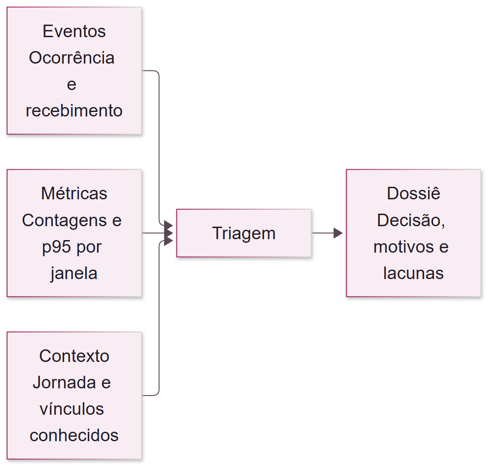
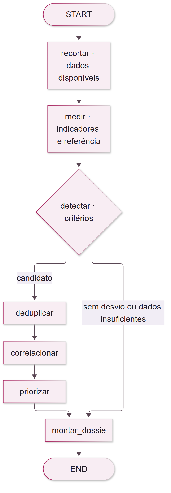

# Aula 02 · Detecção e correlação de eventos

O que merece investigação quando chegam vários sinais ao mesmo tempo? Acompanhe uma jornada Pix fictícia e produza uma fila de triagem explicável com Python e LangGraph. A aula é de 10/11/2026 e o incidente analisado ocorreu em 03/11/2026.

Abra o [notebook da aula](02-deteccao-e-correlacao-de-eventos.ipynb) para seguir o caso, explorar o grafo e acrescentar um nó que prepara o contexto para um assistente de investigação.

## Executar no VS Code

Na raiz da aula, use o [uv](https://docs.astral.sh/uv/getting-started/installation/) para criar o ambiente com Python 3.12 e instalar as dependências registradas.

**Windows · PowerShell**

```powershell
cd projeto
uv sync --frozen --python 3.12
.\.venv\Scripts\Activate.ps1
```

**macOS ou Linux · bash/zsh**

```bash
cd projeto
uv sync --frozen --python 3.12
source .venv/bin/activate
```

**No editor**, abra o [notebook da aula](02-deteccao-e-correlacao-de-eventos.ipynb) com as extensões Python e Jupyter do VS Code. Em **Selecionar kernel → Ambientes Python**, escolha `projeto/.venv/Scripts/python.exe` no Windows ou `projeto/.venv/bin/python` no macOS ou Linux. Execute de cima para baixo. A primeira célula confirma **11 observações e 7 janelas**.

Pra rodar a suíte de testes no terminal, dentro de `projeto`, use `uv run --frozen pytest`.

## Arquitetura



O projeto lê eventos disponíveis pelo horário de recebimento e métricas disponíveis pelo fechamento da janela. Depois mede impacto e latência, avalia os limiares e, quando encontra um candidato, classifica os registros e justifica a prioridade.



[Mermaid do processo](projeto/assets/06-processo.mmd) · [Mermaid do grafo completo](projeto/assets/07-grafo.mmd)

| Arquivo | O que abrir |
|---|---|
| [evidencias.json](projeto/data/evidencias.json) | Registros individuais com ocorrência e recebimento. |
| [metricas.json](projeto/data/metricas.json) | Contagens e p95 em janelas de cinco minutos. |
| [contratos.py](projeto/src/aiops/contratos.py) | Campos aceitos e validação de horários e contagens. |
| [dados.py](projeto/src/aiops/dados.py) | Leitura e seleção do que estava disponível no corte. |
| [triagem.py](projeto/src/aiops/triagem.py) | Nós Python, limiares, contexto da jornada, conexões e dossiê. |
| [test_triagem.py](projeto/tests/test_triagem.py) | Cenários verificáveis do detector e da correlação. |

## Ler a saída

- **Candidato** indica um critério disparado. A prioridade vem do impacto conhecido e da regra do laboratório.
- **Sem desvio** indica que os critérios avaliados ficaram abaixo dos limiares configurados.
- **Dados insuficientes** indica que faltou informação necessária para concluir a avaliação.
- **Dossiê** reúne janela, referência, corte, medições, critérios, evidências, motivos e lacunas. A classificação orienta a investigação de causa.

Os dados e o SLO são didáticos. O cenário representa uma jornada fictícia.

