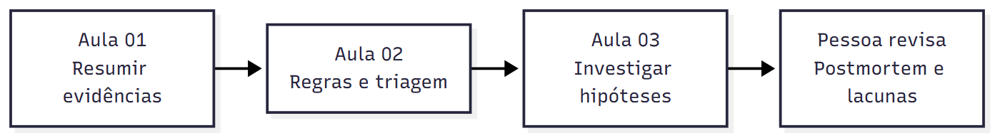
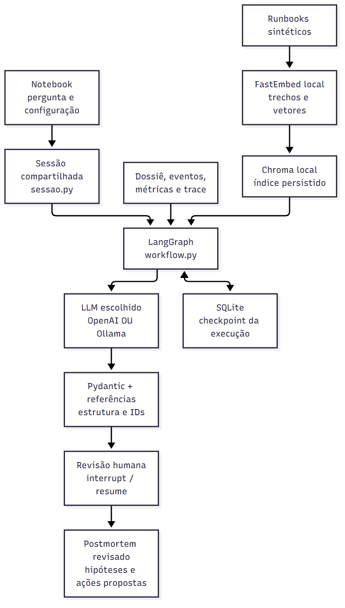
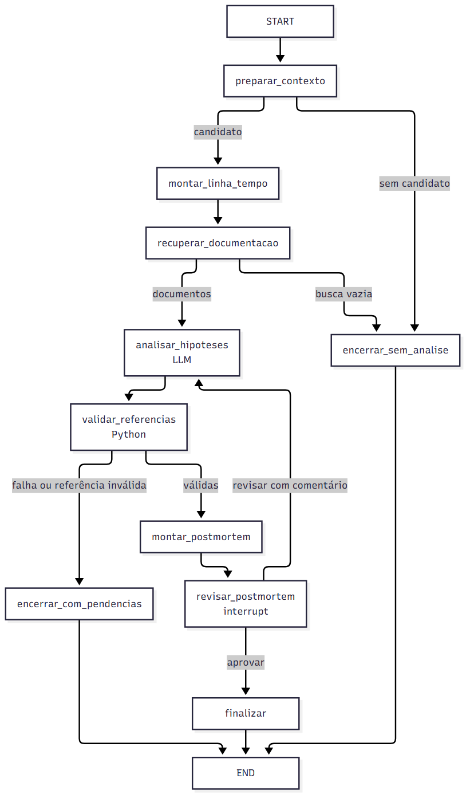
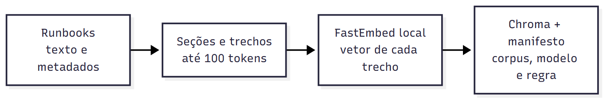
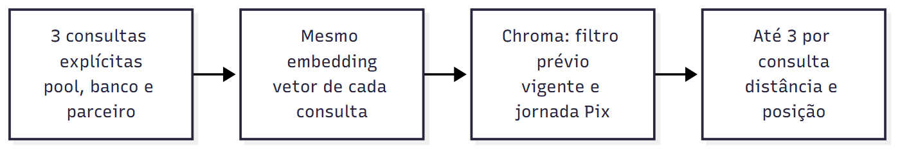
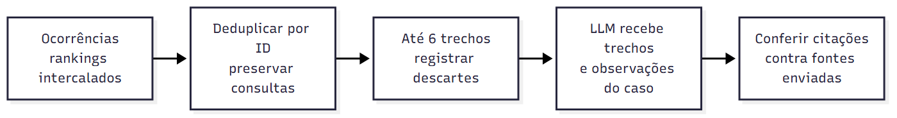

# Aula 03 · RCA assistido por IA

**Das evidências às hipóteses e ao postmortem.** Vamos usar a triagem do caso Pix para investigar explicações concorrentes, consultar documentação e revisar um relatório. RCA significa análise de causa raiz; o programa não confirma uma causa automaticamente.

Na Aula 02, calculamos **80 falhas em 1.000 solicitações = 8%**, reconhecemos a duplicata E03 e produzimos uma fila. Agora usamos esse resultado para examinar o mecanismo da espera por conexão. A data da aula é 12/11/2026; o incidente fictício continua sendo de 03/11.

## Abrir no VS Code

Em **Arquivo → Abrir Pasta**, selecione `03-rca-assistido`. Os dois notebooks ficam na raiz e cada um usa seu próprio ambiente Python.

| Ordem | Notebook | Pasta da venv |
|---|---|---|
| 00 · Extra | [Ollama e modelos locais](00-extra-ollama.ipynb) | `.venv` |
| 03 · Aula | [RCA assistido por IA](03-rca-assistido-por-ia.ipynb) | `projeto/.venv` |

### 00 · Extra de Ollama

O [tutorial](00-extra-ollama.ipynb) usa a triagem do Pix para mostrar uma chamada local e sua integração com LangGraph. A seção **5. Preparar o computador e o kernel** traz os comandos de instalação, download e conferência do modelo.

> **Terminal · PowerShell**
>
> Abra o terminal na pasta `03-rca-assistido` e prepare o ambiente do extra.
>
> ```powershell
> uv sync --frozen --python 3.12
> ```
>
> Selecione `.venv/Scripts/python.exe` como kernel no Windows ou `.venv/bin/python` no macOS e Linux. O tutorial lê os [contextos do Pix](data/contextos-pix.json) e usa o Ollama local por padrão.

### 03 · RCA assistido por IA

O [notebook da Aula 03](03-rca-assistido-por-ia.ipynb) tem a preparação completa na seção **2. Preparar o projeto**. Use `projeto/.venv/Scripts/python.exe` como kernel no Windows.

> **Terminal · PowerShell**
>
> Na raiz `03-rca-assistido`, entre na pasta do projeto.
>
> ```powershell
> cd .\projeto
> ```

> **Terminal · PowerShell**
>
> Em `projeto`, instale as dependências do RCA.
>
> ```powershell
> uv sync --python 3.12
> ```

| Escolha na célula inicial | Preparação |
|---|---|
| `PROVEDOR = "openai"` | Preencha `OPENAI_API_KEY` no `.env` ao lado dos notebooks. Use o [arquivo de exemplo](.env.example) para criar a configuração. |
| `PROVEDOR = "ollama"` | Deixe o servidor Ollama ativo e `qwen2.5:7b` disponível, conforme o tutorial extra. Os dois notebooks leem `OLLAMA_BASE_URL` do `.env` na raiz. |

Na execução com Ollama, o formato da resposta restringe as citações aos IDs enviados e exige que cada hipótese indique seus limites e o que falta verificar. O grafo confere as referências antes de encaminhar a análise à revisão humana.

Na seção **Construir e consultar o índice**, `indice.preparar()` faz o primeiro download do modelo de embeddings. O cache, o índice e os checkpoints são criados em [dados_locais](projeto/dados_locais/README.md).

## O que recebemos e o que entregamos

| Entrada | Trabalho | Saída |
|---|---|---|
| Contexto e dossiê da Aula 02 | Preservar cálculo e classificações. | Impacto e lacunas conhecidos. |
| Eventos, métricas e trace | Aplicar corte e reconstruir a sequência. | Linha do tempo com fontes. |
| Runbooks sintéticos | Recuperar documentação relevante. | Trechos enviados e referências citadas. |
| Análise do modelo | Confrontar hipóteses e conferir IDs. | Postmortem pausado para revisão. |
| Decisão da pessoa | Aprovar ou solicitar revisão da versão lida. | Documento revisado ou nova análise com comentário. |



## Arquitetura



O notebook usa o mesmo serviço que os testes. O LangGraph organiza funções Python; apenas os nós de análise e, no exercício, de verificações chamam o LLM. Chroma guarda documentação. SQLite guarda o estado da execução. Um armazenamento não substitui o outro.

### Grafo completo



Sem candidato ou sem documento recuperado, não há inferência. Erros de modelo e referências inválidas não chegam à aprovação. A revisão usa `interrupt`, checkpoint e `Command(resume=...)` reais. A geração fica fora do nó de pausa.

### Arquitetura do RAG

**Preparação do índice**



**Busca da documentação aplicável**



**Seleção do contexto e conferência**



**Indexação:** Markdown com metadados → seções → trechos de até 100 tokens → embedding local → Chroma com manifesto. O modelo `sentence-transformers/paraphrase-multilingual-MiniLM-L12-v2` é o mesmo na preparação e na consulta.

**Investigação:** três consultas explícitas → filtro de vigência/jornada antes do ranking → até três trechos por consulta → deduplicação por ID → seleção intercalada de até seis trechos → envio ao LLM com observações → checagem das referências.

Um trecho próximo da consulta pode explicar um mecanismo sem comprovar que ele ocorreu no incidente. A distância vetorial não é confiança na resposta. O manifesto impede reutilização silenciosa de corpus incompatível.

## Mapa do código

| Quero entender… | Arquivo e função |
|---|---|
| Como recebemos a Aula 02 | [dados.py](projeto/src/aiops_rca/dados.py), `entrada_pix` e `selecionar_contexto`. |
| Quais campos o modelo deve devolver | [contratos.py](projeto/src/aiops_rca/contratos.py), `AnaliseRCA` e `PlanoVerificacoes`. |
| Onde a IA é chamada | [modelos.py](projeto/src/aiops_rca/modelos.py), `ClienteModelo.gerar`. |
| Como a documentação é buscada | [rag.py](projeto/src/aiops_rca/rag.py), `preparar` e `buscar`. |
| Quais nós existem | [workflow.py](projeto/src/aiops_rca/workflow.py), `configurar_fluxo_rca` e `montar_grafo`. |
| Como guardar e retomar | [sessao.py](projeto/src/aiops_rca/sessao.py), `iniciar`, `consultar` e `decidir`. |
| Como ler o resultado | [visual.py](projeto/src/aiops_rca/visual.py), `matriz`, `tabela_fontes`, `mostrar_resultado`. |
| De onde vieram os dados | [origem.json](projeto/data/origem.json), com hashes dos insumos da Aula 02. |
| Como editar os diagramas | [assets](projeto/assets/), fontes `.mmd` junto das imagens. |

## Percurso de estudo

A execução padrão percorre a demonstração. Para rodar os exercícios, complete as células indicadas e ative `RODAR_EXERCICIO_MEDIO` ou `RODAR_EXERCICIO_HARD` nas respectivas seções.

1. **Abrir o contexto recebido:** compare pacote compacto e dossiê.
2. **Reconstruir a linha do tempo:** separe ocorrência, recebimento, janela e corte.
3. **Ler o trace T01:** interprete spans aninhados, sem somá-los.
4. **Conhecer a documentação:** distinga observação de orientação.
5. **Construir e consultar o índice:** acompanhe um trecho até o contexto.
6. **Montar e executar o grafo:** veja funções, condições e chamada ao LLM.
7. **Conferir e revisar o postmortem:** leia a versão e envie sua decisão.
8. **Exercício médio:** acrescente um nó de verificações.
9. **Exercício hard:** amplie o corpus e filtre documentação aplicável.

Aprovar uma versão finaliza o documento. Solicitar revisão exige comentário e produz outra análise. `DECISAO=None` preserva a pausa ao executar o notebook inteiro. Reabrir uma execução apenas lê o checkpoint; uma nova investigação recebe outro ID.

## Testar

Na pasta `projeto`, com a venv ativa:

```powershell
python -m pytest -q
```

Os testes usam dublês para falhas e contratos. As demonstrações do notebook usam inferência real. A execução principal chama uma vez o modelo; cada exercício completo chama duas vezes, uma para analisar e outra para propor verificações. Solicitar revisão gera novas chamadas explícitas.

## Limites e referências

O cenário, os runbooks e as ações propostas são didáticos. Um trace e amostras pontuais não representam todo um sistema. A hipótese mais sustentada não é automaticamente causa confirmada. Não há remediação, monitoramento contínuo ou autorização operacional neste projeto. LangSmith não é necessário nesta aula; o registro de execução é local.

[Apresentação da Aula 03](https://docs.google.com/presentation/d/1JZo6wgiNgaZXMBOjKSUrcz2HEDqbHy25OavFgnrX0JM/edit) · [LangGraph](https://docs.langchain.com/oss/python/langgraph/overview) · [Interrupções](https://docs.langchain.com/oss/python/langgraph/interrupts) · [Ollama](https://docs.ollama.com/capabilities/structured-outputs) · [OpenAI](https://developers.openai.com/api/docs/guides/structured-outputs) · [Chroma](https://docs.trychroma.com/) · [Postmortems no Google SRE](https://sre.google/workbook/postmortem-culture/)
