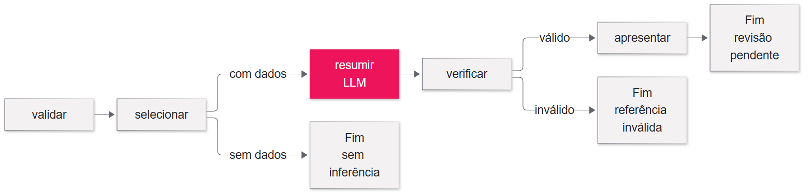

# Aula 01 · Fundamentos de AIOps

Como transformar sinais de um incidente em um resumo que podemos conferir? Nesta aula, acompanhamos uma transferência Pix fictícia, lemos suas evidências e usamos um LLM para organizar fatos, hipóteses, lacunas e perguntas de investigação.

O cenário não descreve a infraestrutura nem as políticas do Banco do Brasil. O programa trabalha com dados sintéticos locais e não executa mudanças operacionais.

## Comece aqui

1. Abra esta pasta no VS Code.
2. Abra [01-demonstracao.ipynb](01-fundamentos-aiops/01-demonstracao.ipynb): ele explica o caso, os termos e cada passagem do código.
3. Para participar sem programar, vá à seção **Atividade: propor um piloto de AIOps**, no final do notebook. Escolha médio ou hard e responda em texto ou tabela.

## Preparar para executar o notebook

Você precisa de VS Code com as extensões Python e Jupyter, `uv`, Python 3.12 e acesso ao modelo OpenAI escolhido. Para a atividade em texto, basta ler o notebook.

**Terminal PowerShell, na raiz desta pasta.** Entre no projeto:

```powershell
cd projeto
```

Instale as versões registradas no lock. O ambiente será criado em `projeto/.venv`:

```powershell
uv sync --frozen --python 3.12
```

**No Explorer**, copie `projeto/.env.example` para `projeto/.env`. Preencha `OPENAI_API_KEY` e confira `OPENAI_MODEL`. Mantenha a chave privada. A aplicação carrega somente esse arquivo de configuração.

**No terminal, ainda dentro de projeto**, confira as dependências:

```powershell
uv pip check
```

Execute os testes locais. Eles não enviam requisições aos modelos:

```powershell
uv run --frozen pytest
```

**No notebook**, clique em **Selecionar Kernel → Ambientes Python** e escolha `projeto/.venv/Scripts/python.exe`. O kernel executa as células Python. Não é preciso ativar a venv no terminal nem usar `Set-ExecutionPolicy`: `uv run` já usa o ambiente do projeto.

As três células com inferência estão identificadas. Executá-las novamente pode gerar custo; as células de tabelas e comparação reutilizam resultados. Em caso de falha, confira a mensagem, a configuração do modelo e o acesso à API antes de continuar.

## Como o exemplo funciona



[Fonte Mermaid](projeto/assets/02-workflow.mmd)

Python valida os dados e seleciona o que já chegou no horário escolhido. O LLM redige o resumo. O programa confere campos e referências, e uma pessoa confronta as afirmações com as fontes.

Se o recorte estiver vazio, o workflow encerra sem chamar o modelo. Uma entrada inválida ou falha da API gera um erro visível. `AGUARDANDO_REVISAO` significa que o programa terminou e o conteúdo aguarda leitura humana; não é uma aprovação nem uma pausa técnica com retomada.

| Arquivo de apoio | Responsabilidade |
|---|---|
| `projeto/src/aiops/contratos.py` | Define evidência, resumo, hipótese e verificação |
| `projeto/src/aiops/dados.py` | Lê os JSONs e seleciona dados por horário |
| `projeto/src/aiops/modelo.py` | Prepara mensagens, cliente e chamada real |
| `projeto/src/aiops/validacao.py` | Confere estrutura e IDs citados |
| `projeto/src/aiops/apresentacao.py` | Organiza tabelas sem repetir inferências |
| `01-fundamentos-aiops/01-demonstracao.ipynb` | Explica os conceitos e constrói os nós e conexões |

## Como interpretar os resultados

- O registro de CPU do banco em 35% (E09) ocorreu às 10h01 e chegou às 10h06. Só pode ser usado depois que chegou à base.
- Na experiência sem esse registro, o modelo é orientado a declarar que a informação de CPU está ausente. O caso verifica o cumprimento dessa orientação.
- A resposta da IA contém fatos, hipóteses, lacunas e perguntas. As tabelas mostram as partes de uma única resposta estruturada.
- As respostas ficam na memória do kernel. Reiniciar o kernel apaga as variáveis, mesmo que as saídas anteriores continuem visíveis no notebook.
- A conferência de IDs não garante que cada frase esteja correta. Compare as afirmações com as observações citadas.
- `AGUARDANDO_REVISAO` informa que o grafo terminou e o rascunho precisa de leitura humana. Não há pausa e retomada de aprovação implementadas.
